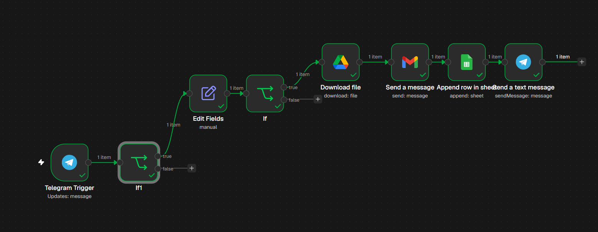

# Telegram Cold Mail Automation 🚀

An automated cold-emailing system built with **n8n, Telegram, Gmail, Google Drive, and Google Sheets**.

Send a recruiter's email address to your Telegram bot, and the workflow automatically sends a professional email with your resume attached. Every successful email is recorded in Google Sheets, and you receive a Telegram confirmation
## 📸 Workflow Architecture



## ✨ Features

- **Telegram Integration:** Trigger the automation by sending an email address to your Telegram bot.
- **User Authentication:** Restricts workflow access to an authorized Telegram user ID.
- **Email Validation:** Validates the format of the recipient's email address.
- **Automated Resume Attachment:** Fetches your resume PDF from Google Drive.
- **Automated Email Sending:** Sends a professionally formatted plain-text email using Gmail.
- **Application Tracking:** Records recipient email, date, and sending status in Google Sheets.
- **Telegram Notifications:** Sends a confirmation after successful execution.

## 🛠️ Tech Stack

| Technology | Purpose |
|---|---|
| n8n | Workflow automation |
| Telegram Bot API | User interaction and notifications |
| Gmail API | Sending emails |
| Google Drive API | Resume storage and retrieval |
| Google Sheets API | Application tracking |

## ⚙️ Workflow Execution

The automation follows this sequence:

1. **Telegram Trigger:** Receives a message containing the recruiter's email address.
2. **User Authentication:** Checks whether the Telegram sender's ID matches the authorized user.
3. **Edit Fields:** Extracts the recipient email address.
4. **Email Validation:** Checks whether the provided email follows a valid format.
5. **Google Drive:** Downloads the resume PDF.
6. **Gmail:** Sends the application email with the resume attached.
7. **Google Sheets:** Records the recipient email, timestamp, and sending status.
8. **Telegram Notification:** Sends a confirmation message after successful execution.

## 📋 Prerequisites

Before setting up the workflow, you need:

- An n8n Cloud account or self-hosted n8n instance.
- A Telegram bot created using [@BotFather](https://t.me/BotFather).
- A Gmail account.
- A Google Drive account.
- A Google Sheets spreadsheet.

## 🚀 Setup Instructions

### 1. Clone the Repository

```bash
git clone https://github.com/YOUR_USERNAME/telegram-cold-mailer.git
```

Navigate into the project:

```bash
cd telegram-cold-mailer
```

### 2. Import the Workflow

1. Open your n8n dashboard.
2. Create a new workflow.
3. Import `workflows/telegram-cold-mailer.json`.
4. Review the imported nodes and configure the required credentials.

### 3. Configure Telegram

1. Create a Telegram bot using [@BotFather](https://t.me/BotFather).
2. Generate your bot API token.
3. Add Telegram credentials in n8n.
4. Configure the Telegram Trigger and Telegram notification nodes.
5. Replace the placeholder Telegram user ID in the authentication IF node with your own numeric Telegram user ID.

### 4. Configure Google Drive

1. Upload your resume PDF to Google Drive.
2. Connect your Google Drive account to n8n.
3. Select your resume in the Download File node.
4. Ensure the downloaded binary file is passed to the Gmail attachment field.

### 5. Configure Gmail

1. Connect your Gmail account using OAuth2 credentials.
2. Review the recipient, subject, and email body.
3. Personalize the email template.
4. Verify that the resume attachment is correctly configured.

### 6. Configure Google Sheets

Create a spreadsheet with the following columns:

| Email | Date sent | Status |
|---|---|---|

Connect your Google Sheets account and select your spreadsheet in the Append Row node.

### 7. Activate the Workflow

1. Test the workflow using your own email address.
2. Verify that the email and resume attachment arrive correctly.
3. Confirm that Google Sheets records the application.
4. Verify Telegram authentication using another account.
5. Activate or publish the workflow in n8n.

## 💬 How to Use

Once the workflow is active:

1. Open your Telegram bot.
2. Send the recruiter's email address.

Example:

```text
recruiter@example.com
```

3. The workflow validates the address.
4. Gmail sends your introduction email with your resume attached.
5. Google Sheets records the successful send.
6. Telegram sends a confirmation.

## 🔐 Security Considerations

- Never expose Telegram bot tokens or OAuth credentials.
- Never commit personal resume files or private contact information.
- Keep the Telegram user authentication condition enabled.
- Replace all placeholder IDs with your own values after importing.
- Do not upload raw workflow exports containing private identifiers.
- Use n8n credentials instead of hardcoding API secrets.

**Note:** The workflow JSON in this repository is sanitized for public sharing. Credentials and personal resource IDs must be configured separately.

## ⚠️ Limitations

- Email validation checks address format, not whether the mailbox exists.
- Successful execution does not guarantee inbox placement or that the recipient reads the email.
- Duplicate email detection is not currently implemented.
- The email template is predefined and does not dynamically personalize messages.
- The workflow is designed for individual professional outreach, not bulk email campaigns.

## 🎯 Project Objective

The objective of this project is to simplify repetitive job application outreach through workflow automation.

It demonstrates how different services can be integrated using n8n to build a practical automation system with authentication, validation, file handling, email delivery, and application tracking.

---

**Built with ❤️ using n8n**
